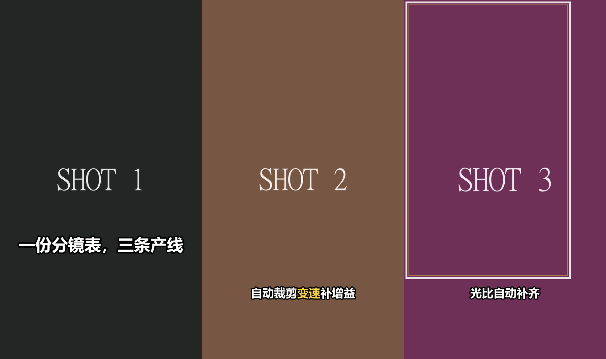

# 剪匠 · cutwright

> 一份分镜表 JSON，三条产线：**直出成片**、**剪映草稿**、**达芬奇时间线**。

[](#测试)
[](#安装)
[](#设计取舍抄了什么扔了什么)
[](LICENSE)

摄影师剪一条竖屏口播，真正花时间的不是调色和转场，是**把 36 个镜头按 86 秒排好、
把 21 条字幕卡在呼吸点上、把 6 段旁白对齐、再让配乐在结尾刚好收住**。这些是排布
问题，不是审美问题——排布问题就该被写成数据，然后交给机器。

剪匠做的就是这件事：你（或 agent）写一份 `shotlist.json`，它负责变成片子。
三条产线共用同一份 IR，换后端不换分镜表。

```bash
# 1. 本机能不能干这活
cutwright doctor

# 2. 生成一份能直接跑的示例：分镜表 + 用 ffmpeg 现造的素材（不需要你准备任何东西）
cutwright init demo --with-media && cd demo

# 3. 三步走：查 → 排 → 出
cutwright validate shotlist.json --check-files
cutwright plan     shotlist.json --target 45
cutwright build    shotlist.json --backend ffmpeg -o out
```

`build` 结束时会自动体检成片（时长 / 分辨率 / 音轨 / 黑场 / 长静音），
**不以「跑完了」为成功，以「实测数字对得上」为成功**。

赶时间先看节奏？同一条命令加 `--fast`：切片与成片都换成更快的编码档（画质略降），
1080×1920 的一条 7 镜片从「几分钟」压到「几十秒」，而且切片的缓存键不同、
不会污染之后交付档的缓存。它会在末尾明确提醒你「这是预览、别拿去交付」。
`--dry-run` 现在对 ffmpeg 后端也有效（以前只有剪映/达芬奇认），先把每一段切片的
来源、入点、时长与成片路径列出来，不建目录也不起 ffmpeg。



上面三帧来自仓库自带的 demo（`examples/demo`，素材全部用 ffmpeg lavfi 现造）：
左是 `title` 卡，中是关键词换色（`"自动裁剪｜变速｜补增益"`，分隔符本身不印出来），
右是 `image_overlays` 的竖屏画框——它的 alpha 是真的，画面从框里透出来。

## 三条产线

| 后端 | 产物 | 需要什么 | 适合谁 |
|---|---|---|---|
| `ffmpeg` | 一条 MP4（H.264 + AAC，竖屏 1080×1920） | 只要 ffmpeg | 要**立刻拿到成片**、要能进 CI、要脱离剪映 |
| `jianying` | 剪映 11.6 草稿目录（可直接打开继续改） | 剪映专业版 11.x | 要**草稿可编辑**、要在剪映里加自己的特效/贴纸/音效库 |
| `resolve` | 达芬奇时间线（逐镜入轨 + 可选 LUT 调色） | 达芬奇 Studio + 外部脚本开启 | 要**专业调色与交付**、要做多版本 |

三个后端读的是同一份 `shotlist.json`。同一份分镜表，今天用 ffmpeg 出个预览，
明天丢进剪映改花字，后天进达芬奇调色——分镜表不用动。

```bash
cutwright build shotlist.json -b jianying --opt install=true   # 生成并装进草稿库
cutwright build shotlist.json -b resolve  --opt grade=lut.cube # 建线并逐镜套 LUT
```

## 分镜表长什么样

```json
{
  "name": "宝妈第三期",
  "canvas": { "width": 1080, "height": 1920 },
  "fps": 30,
  "video_segments": [
    { "file": "clip01.mp4", "src_start": 2.0, "src_dur": 3.2, "zoom": "in", "zoom_amount": 0.06 },
    { "file": "clip02.mp4", "src_start": 0.0, "src_dur": 2.4, "speed": 1.25, "cx": 0.4 }
  ],
  "text_segments": [
    { "text": "这样拍|竖屏才好看", "tl_start": 0.4, "tl_dur": 2.2, "style": "caption" }
  ],
  "vo_segments": [
    { "text": "先站稳，再取景。", "tl_start": 0.5, "tl_dur": 3.0, "style": "vo_hidden" }
  ],
  "audio_segments": [
    { "file": "bgm.mp3", "tl_start": 0, "tl_dur": 8.5, "kind": "music" }
  ]
}
```

四条约定，够用一辈子：

1. **`tl_start` 可以不写**——不写就按顺序首尾相接，改镜头顺序不用重排时间码。
2. **关键词用 `|` 或 `｜` 成对括起来**（半角全角都认），中间那段走 `keyword_color`；
   分隔符本身不出现在画面上。
3. **旁白只出声不出字**——样式必须 `invisible`，否则会糊在画面上，`qc` 会拦。
4. **手写错了不会炸**——数值写字符串、字段名写成 `src`、多写几个自定义键，都能吃进去，
   未知字段原样保留在输出里。

完整字段见 [references/shotlist-schema.md](skills/cutwright/references/shotlist-schema.md)。

## 有剧本的话，不用手写分镜表

短剧、对话戏、解说台本这类内容，你不该去数「第 17 个镜头从哪帧开始」。写戏，剩下的交给机器：

```bash
cutwright index materials -o materials.json     # 扫素材：按文件名打标签、量时长
cutwright story screenplay.json --index materials.json -o shotlist.json
cutwright build shotlist.json -o out            # 后面和手排分镜表完全一样
```

```json
{
  "name": "地铁追凶 第1集",
  "canvas": { "width": 1080, "height": 1920 },
  "cast": { "lin": "林队", "zhou": "周小满" },
  "music": { "file": "materials/bgm.mp3", "gain_db": -20 },
  "scenes": [
    {
      "id": "S1", "tags": ["subway", "night"],
      "lines": [
        { "type": "action", "text": "末班车进站，人群散开" },
        { "who": "zhou", "text": "你确定他会来？" },
        { "who": "lin", "text": "他欠我一条命", "duration": 2.4 }
      ]
    }
  ]
}
```

`story` 干三件事：按台词估时长（有旁白音频就用音频真实时长）、把长台词切成带节奏的镜头、
按「场次标签 + 人物 + 景别」从素材库里挑画面。挑不动会明说哪句没素材，不会拿占位符糊过去。

```console
$ cutwright story examples/story/screenplay.json --index examples/story/materials.json
剧本 地铁追凶 第1集 → examples/story/shotlist.json
  3 场 / 8 句 → 8 镜 / 0:12.90
    S1        4.93s  3 镜  地铁站台 · 夜
    S2        5.90s  3 镜  车厢 · 夜
    S3        2.07s  2 镜  出口 · 夜
  字幕 7 条  旁白 1 段  音频 1 条
```

规则与坑：剧本字段 [references/screenplay-schema.md](skills/cutwright/references/screenplay-schema.md)，
产线流程 [references/story-workflow.md](skills/cutwright/references/story-workflow.md)。
可直接跑的例子在 [`examples/story/`](examples/story)（`python examples/story/make_media.py` 会现造素材）。

## 剪映里剪过的，也能读回来

写草稿只解决一半问题。别人在剪映里手剪了一版，你要么认命重排，要么把它变回数据：

```console
$ cutwright import "C:\Users\me\...\com.lveditor.draft\我的草稿" -o shotlist.json
我的草稿：21 镜 / 14 条字幕 / 2 条音频 / 1080x1920 / 63.40s
  → shotlist.json：21 镜 / 14 条字幕 / 2 条音频 / 1:03.40
  下一步: cutwright validate shotlist.json --check-files
```

读的是**排布**，不是像素：镜头的出入点、变速、字幕文案与时间、音频位置都拿回来了。
字幕还会尽量像原来那样摆：**颜色、上下位置、有没有描边、关键词高亮**都从草稿里认出来
（`text_color` / `clip.transform.y` / `border_width` / `subtitle_keywords`），
同一组归成一个命名样式；**字号和描边粗细用画布默认**——剪映的 `font_size` 没有公开单位，
换算成 px 只能靠试，猜错比不猜更糟。转场、关键帧、特效不还原；草稿里的旁白和字幕
也分不开，一律按字幕处理。加密草稿要本机有能用的 `videoeditor.dll`，没有就报错，不会
悄悄给你一份空表；素材换了机器路径失效时，它会先列表告你多少条已经不在。


（上面这一帧是从真草稿 `11月13日` 读回、重新渲染出来的：黄字保持在画面顶部，
关键词位置也对得上。原来这条线读回来是一律白色底部字幕。）

读回来的时候会**说清丢了多少**：转场几个、特效/滤镜几个、关键帧几个，命令行直接列出
`不还原: 转场 2 个、特效/滤镜 1 个、关键帧 2 个`——只说「不还原」你不知道损失大不大。

图片段不会被当成「没画面」丢掉：它们是静帧，读回来是 `"still": true` 的镜头，重建时
按同样时长铺一张图。剪映把朗读音频存在草稿目录里、路径写成
`##_draftpath_placeholder_<uuid>_##/textReading/…`，这类路径会先还原成草稿目录下的真路径，
否则你会拿到一条指向 `workspace/##_draftpath…` 的假报错。

## 图片也是镜头

`"still": true` 让 `file` 变成一张图片（png/jpg/webp），按 `src_dur` 铺时长：

```json
{"file": "card.png", "src_dur": 2.5, "still": true}
```

静帧没有入点、不能变速（写了 `src_start`/`speed` 会报 `W042`/`W043` 并忽略），
三条产线都认它：ffmpeg 直出用 `-loop 1` 铺帧，剪映写成 `type=photo` 素材，
达芬奇放进媒体池。图文号、观点卡、封面停 2 秒，都不用为了「一张图」另开一个工程。

## 重复渲只重切改过的镜头

切片按内容摘要命名（`_build/seg_<digest>.mp4`），同一份素材、同一组参数第二次渲染
直接复用；`--opt jobs=4` 让多镜并行，`--fast`（= `--opt preview=true`）用低码率快编
一版看节奏。实测（8 镜 / 12.9s / 1080×1920）：串行 9.44s → 并行 7.85s → 并行 + 命中缓存 5.58s。
镜头越多、缓存的差距越大——改一条字幕不该重切 40 个镜头。

这些数字是**电脑上**的。CI 的 2 核 runner 慢得多，所以冒烟用例换成了自带的小样
`examples/demo/shotlist-ci.json`（540×960 / 4 镜 / 6 秒），配上 `--fast` 本机 6 秒渲完；
之前那条 1080p 的 19 分钟冒烟，现在整条流水线几十秒收工。

## 安装

```bash
git clone https://github.com/CodeVoyagerht/cutwright.git
cd cutwright
pip install -e .            # 核心零依赖
pip install -e ".[render]"  # 需要烧字幕/花字时（Pillow）
```

ffmpeg 单独装：`winget install Gyan.FFmpeg` / `brew install ffmpeg` / 直接丢两个 exe
到 PATH。找不到时 `cutwright doctor` 会告诉你缺哪个，也可以用 `CUTWRIGHT_FFMPEG` 指定。

想让朋友也装上、或者拉完更新怎么同步，见 [docs/install-and-update.md](docs/install-and-update.md)。

## 作为 Agent Skill 使用

仓库自带一份 [SKILL.md](skills/cutwright/SKILL.md)，按 [Agent Skills 规范](https://agentskills.io/specification)
写成（渐进式披露：元数据 ≈100 tokens 常驻，正文按需加载，长文进 `references/`）。

```bash
# 装到各家 skill 目录（同一份真源，软链到各处）
python skills/cutwright/scripts/install.py --target all
```

支持 Claude Code / Cursor / Codex / Gemini CLI 的默认路径。写这份技能时踩过的
坑与取舍，见 [docs/design-notes.md](docs/design-notes.md)。

## 命令一览

| 命令 | 作用 | 副作用 |
|---|---|---|
| `doctor` | ffmpeg / 剪映 / 达芬奇 是否就绪，各后端可用性 | 无 |
| `backends` | 后端清单（JSON） | 无 |
| `validate` | 静态检查分镜表，`--check-files` 连素材一起查 | 无 |
| `plan` | 统计 + 时长拟合（`--target` / `--strategy trim\|speed`） | 无（`--out` 才写文件） |
| `build` | 构建草稿 / 时间线 / 成片 | **写文件** |
| `qc` | 时间线体检；给 `--mp4` 则连成片一起 | 无 |
| `index` | 扫素材目录 → 索引（按文件名打标签、量可用时长） | 写文件 |
| `story` | 剧本 + 索引 → 分镜表，打印分场报告 | 写文件 |
| `import` | 剪映草稿 → 分镜表（明文或加密草稿） | 写文件 |
| `init` | 生成可用示例 | 写文件 |

所有命令都接受 `--json`：**stdout 只有一份合法 JSON，日志全走 stderr，退出码说真话**
（0 = 可以继续，1 = 有 error 级问题，2 = 用法错误）。这是给 agent 用的，也是给人
写 shell 判断用的。

## 设计取舍：抄了什么、扔了什么

做这个项目之前读了 Agent Skills 规范、`anthropics/skills`、pyJianYingDraft、
以及自己以前跑通过的两条私有管线。留下的是能落地的，扔掉的是听起来对的。

**抄了**

| 来源 | 抄的是什么 | 为什么 |
|---|---|---|
| Agent Skills 规范 | 三层披露 / 6 字段 frontmatter / name=目录名 | 元数据常驻、正文按需、资源懒加载，才撑得住技能库变大 |
| `anthropics/skills` 的 `pdf` 与 `skill-creator` | 确定性步骤脚本化 + 自带 `validate` 脚本 | 「看起来对」不可复现，exit code 才算验收 |
| `obra/superpowers` | 硬性检查点（hard gate） | 渲到一半才发现有空档，代价是一个小时 |
| pyJianYingDraft | 明文草稿的 schema 建模方式 | 但**只学建模，不学它放弃加密** |
| 自己的 `render_video.py` | HDR→SDR 的 zscale、zoompan 表达式、按 `volumedetect` 补增益 | 都是实测调出来的数字，重写一遍只会更差 |
| CineMatchAI | 逐镜分析 → 逐镜调色的循环结构 | 「一镜一决策」比「整片一个 LUT」稳得多 |

**扔了**

| 扔掉的 | 为什么 |
|---|---|
| 让模型自己数帧、算时间码 | 采样误差不可复现，且没人能复现 bug；这些全部进 `schema.py` 与 `planner.py` |
| 一个 skill 塞下所有工作流 | 激活精度下降，正文常驻膨胀；这里技能只做「路由 + 步骤」，规格下沉 `references/` |
| 假设已装好剪映/达芬奇 | 换机器即失败，且错误指向技能之外；`doctor` 先说话 |
| 直接把明文写进草稿目录 | 剪映 6.0 起加密，11.6 还有 `Timelines/<UUID>/` 镜像，只写根文件＝白改 |
| `DetectSceneCuts()` | 它会**当场在时间线上打切点**，是破坏性副作用，不是只读分析；切点一律用 ffmpeg 算 |
| 固定字体绝对路径 | 跨机失效；找不到字体就退默认并记 warning，不拦流程 |
| 导出视频自动化 | 剪映 11.x 是 Qt/QML，UIA 一个控件都不暴露；「任何库都能导出」是假的，宁可明说 |

## 测试

```bash
python -m unittest discover -s tests -t .
```

306 个用例，零依赖，`git clone` 完就能跑。真渲染的用例会检测 ffmpeg，没有就 skip
而不是 fail——CI 上的 `windows-latest` 有 ffmpeg，本地没装的开发者也不该被卡住。

这台机器上的实测记录（doctor / validate / plan / build / qc / 剪映草稿 / 306 个用例）
都在 [docs/acceptance.md](docs/acceptance.md)，包括**哪些是未验收项**。

契约测试（`tests/test_cli_contract.py`）锁死的是**机器可读的部分**：`--json` 的字段、
退出码、stderr 与 stdout 的分工。这些一旦漂移，最先坏的是别人的自动化。

### 目视也要过一遍

单测抓不到「字排歪了」「画框是个黑窟窿」这类问题——那得看像素。所以仓库里有一条
真渲染的验收链，`docs/images/demo-frames.png` 就是它的产物：

```bash
python examples/demo/make_media.py --out examples/demo/materials   # 现造素材（含合成的 bgm）
cutwright validate examples/demo/shotlist.json --check-files        # 0 错误 0 警告
cutwright build    examples/demo/shotlist.json -o examples/demo/out # 13.8s 成片
cutwright qc       examples/demo/shotlist.json --mp4 examples/demo/out/demo-reel.mp4
```

`qc` 的 23 项全部要 `OK` 才算过：镜数对得上、首帧从 0 开始、无空档无重叠、变速后在范围内、
响度落在 -14 LUFS ±3、真峰值不超过 -1 dBTP、
字幕都在片长内、旁白不可见、叠加层有效、音轨存在、时长偏差 <0.25s、分辨率一致、
没有超过阈值的黑场与静音。这条链在 CI 的 `render` job 里也会跑，产物作为 artifact 上传。

## 已知边界

- **剪映导出视频不从这里的 API 走**。草稿给你，导出请点剪映的按钮。
- **达芬奇的外部脚本开关只在 Studio 版**。免费版能建线，但别指望命令行自动跑。
- **字体**需要系统里有对应中文字体；`doctor` 不检查字体，渲染时找不到会退默认。
- **剪映草稿库路径**靠「目录里有 `root_meta_info.json`」识别，装在非默认盘也能找到，
  但仍可能有识别不到的特殊布局，此时用 `CUTWRIGHT_JY_DRAFTS` 指定。

## 许可

MIT。素材、字体、音乐请自备并确认授权——这份代码只搬时间线，不搬版权。

---

如果这个项目帮你省下了一个通宵：⭐ 一下，然后把它丢给你的 agent。
