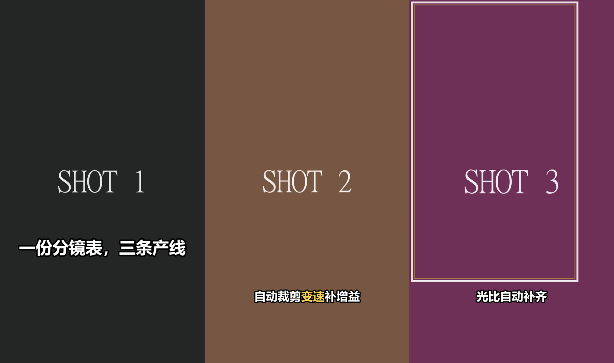

# 验收记录

这台机器上的实测结果，不是「应该能跑」。所有命令都在仓库根目录执行，
`py` 指本机 Python 3.12，`cutwright` 指 `python -m cutwright.cli`
（等价于 `PYTHONPATH=src python -m cutwright`）。

## 0. 环境

| 项 | 值 |
| --- | --- |
| 系统 | Windows 11 |
| Python | 3.12.14（numpy 2.3.5、Pillow 12.3.0） |
| ffmpeg | 9.0.2-essentials_build-www.gyan.dev（`config.discover()` 自动找到） |
| 剪映专业版 | 11.7.0.14652（安装目录）/ 11.6.0.14552（可用的加密 DLL 在这里） |
| 剪映草稿库 | `%LOCALAPPDATA%\JianyingPro\User Data\Projects\com.lveditor.draft` |
| 达芬奇 | 已安装但未开外部脚本（doctor 里如实标出来） |

`cutwright doctor` 的三行结论：

```
[OK] ffmpeg        D:\AutoClip Desktop\resources\ffmpeg\ffmpeg.exe  9.0.2
[OK] jianying      剪映 11.7.0.14652，草稿库 …\com.lveditor.draft
[OK] resolve       C:\ProgramData\Blackmagic Design\DaVinci Resolve\Support
3/3 个后端可用
```

## 1. 结构校验（`validate`）

```
cutwright validate examples\demo\shotlist.json --check-files
0 个错误，0 个警告。 镜头 7 个，时长 0:13.80。
```

`--check-files` 会真的去 stat 每个素材，所以这一条同时证明了
`material_dir` / `asset_dir` 的相对解析是对的。

## 2. 排布（`plan`）

```
7 镜 / 0:13.80 / 1080x1920 @ 30.0fps
平均镜长 1.971s（1.6–2.4s），字幕 6 条、旁白 3 段、叠加 1 层
分幕 hook 2.0s / body 9.8s / end 2.0s
```

## 3. 真渲（`build`）

```
cutwright build examples\demo\shotlist.json -o examples\demo\out
```

产物 `examples\demo\out\demo-reel.mp4`，ffprobe：

```
codec h264 / 1080x1920 / 30 fps / 13.800 s / aac 48000 Hz 双声道 / 636,967 字节
```

中间件留在 `out\_build\`（`seg_000.mp4` … `render.log`），出问题时能直接看到
是哪一段、哪条滤镜炸的。

## 4. 成片体检（`qc`）——20 项全过

```
clips_present  starts_at_zero  no_gaps  no_overlaps  no_zero_length
speed_sane     texts_in_range  vo_hidden  overlays_valid  audio_exists
sources_exist  duration_positive  file_exists  file_nonempty  has_video
duration_match 实际 13.800s vs 期望 13.800s（差 +0.000s）
canvas_match   1080x1920
has_audio      no_long_black      no_long_silence
全部通过。
```

## 5. 目视——单测抓不到的两件事



抽 `1.2s / 3.0s / 9.0s` 三帧拼成一张（左：标题卡；中：关键词换色；右：真 alpha 画框）。
这一步逼出两个只有看像素才会发现的 bug，都已修：

1. **画框是黑窟窿**：生成 PNG 走的是 ffmpeg lavfi，出来的图 alpha 全 255。
   改成用 `cutwright.demo.write_rgba_png()` 手写 RGBA PNG，中心 alpha 严格为 0。
2. **竖线印在画面上**：关键词分隔符只认半角 `|`，文案里写的是全角 `｜`，
   于是竖线原样印出来、关键词也不换色。现在 `|` 和 `｜` 等价，成对交替
   （`自动裁剪｜变速｜补增益` → 白 / 黄 / 白）。

## 6. 剪映草稿（`-b jianying`）

```
cutwright build examples\demo\shotlist.json -b jianying -o .tmp-jy --opt encrypt=true --opt install=false
构建成功（jianying）… encrypted: True
```

17 个文件，根级与 `Timelines\902B0C3F-DE89-4465-B8C7-1FEE818F21B0\` **双写**；
`draft_content.json` 42,636 字节且是 base64 密文（`b'CG7dKmL6B04vDlQZ…'`）。
加密走的是本机 `videoeditor.dll`（11.6.0.14552，先做 encrypt→decrypt 回环自检），
仓库不附带、也不分发这个 DLL。

两条如实写进报告的已知限制：

- 叠加层的淡入 / 滑动 / 悬浮动效还没有映射成剪映关键帧，草稿里按静态图片写；
- 没有模板时 `Timelines/<id>/template.tmp` 不写，缺它是否影响加载未验证。

**读回来（`cutwright import`）**：用同一份 `examples/story/shotlist.json` 写成加密草稿
（`videoeditor.dll` 真加密，36,304 字节），再让 `read_draft` 读回：

```
读回：.tmp-enc-draft：8 镜 / 8 条字幕 / 1 条音频 / 1080x1920 / 12.90s（加密草稿）
--plain-only → 草稿是加密的（draft_content.json），但这次明确不要加载 videoeditor.dll。
```

镜数、字幕数、音频数、画幅、总时长与写之前一致；`--plain-only` 遇密文按设计报错退出。

**读剪映自己手剪的草稿**（`D:\Jianying\JianyingPro Drafts\11月13日`，48,896 字节，
本机 `videoeditor.dll` 解开）：

```
cutwright import "D:\Jianying\JianyingPro Drafts\11月13日" -o real-11-13.json
读回：11月13日：2 镜 / 9 条字幕 / 1 条音频 / 1280x720 / 18.03s（加密草稿）
cutwright validate real-11-13.json --check-files
0 个错误，0 个警告。
cutwright build real-11-13.json -o out
构建成功（ffmpeg）：out\11月13日.mp4，1280x720 @ 30.000fps，18.033s
成片体检 8 项全部 OK（duration_match 差 +0.000s / has_audio / no_long_black / no_long_silence 等）
```

这一步逼出两个真问题，都已修：

1. **图片段被丢掉**：草稿第一条是 `type: "photo"` 的 PNG（0–3s），旧版 `import` 把它当
   「没画面」略过，读回来只有 1 镜、时间线凭空短 3 秒，`validate` 只报一条 `W018`。
   现在图片段按**静帧**（`"still": true`）保留，重建时铺成同样时长。
2. **朗读音频路径成了假路径**：剪映把朗读存在草稿目录下，路径写成
   `##_draftpath_placeholder_<uuid>_##\textReading\….wav`。旧版把它当相对当前目录，
   报出一串指向 `workspace\##_draftpath…` 的 `E051`。现在占位前缀会被还原成草稿目录下的
   真路径，同一条命令变成 `0 个错误，0 个警告`。

## 7. 达芬奇（`-b resolve`）

本机 `import DaVinciResolveScript` 失败（`fusionscript` DLL 找不到，外部脚本没开），
`doctor` 与 `build` 都如实报错并给出排查提示，不假装成功。resolve 后端有
26 个纯 mock 用例覆盖桥接逻辑，但没有在本机真实时间线上跑过——**这是未验收项**。

## 8. 单元测试

```
python -m unittest discover -s tests -t .
Ran 268 tests in 29.230s
OK (skipped=2)
```

两个 skip 是「本机有剪映 DLL」时才会跑的真实草稿回读用例。
全项目零第三方依赖，测试只依赖标准库（`render` / `beats` 两个 extra 是可选的）。

## 9. 长剧本压测（66 镜 / 2:37）

短例子（3 场 8 句）证明不了排片在长剧本上还站得住，所以另造一集：
`examples/stress_long/`，6 场 61 句、5 个演员、14 段素材（比镜头数少得多，逼着它复用）。

```
python examples/stress_long/make_episode.py
cutwright index examples/stress_long/materials -o materials.json   → 14 个镜头
cutwright story examples/stress_long/screenplay.json --index materials.json -o shotlist.json
  → 6 场 / 61 句 → 66 镜 / 2:37.67（S01 12 镜 S02 12 S03 10 S04 10 S05 11 S06 11）
  字幕 56 条  旁白 5 段  音频 1 条
  素材复用 14 段撑 66 镜（最多 7 次）
cutwright validate shotlist.json --check-files → 0 个错误，0 个警告
cutwright build shotlist.json -o out --opt jobs=4 → 157.7s，成片体检 8 项全 OK
cutwright qc shotlist.json --mp4 "out\长夜名单 第1集.mp4" → 20 项全过
```

自检指标：66 镜 / 14 段 = 平均每段用 4.7 次，相邻同源 0 次，镜长 1.00–3.60s（均值 2.39），
时间线断点 0，字幕与旁白都落在画面内。

**压测逼出来的问题（已修）**：长台词被拆成 2 镜时，字幕原先锚在**最后一镜**上，
于是它压到下一句头上——屏幕上同时挂两行字，实测重叠 2.10s（3 处）。
现在字幕锚在这一句的第一镜、时长覆盖它占的**所有**镜。这条只有多镜长句才暴露，
8 句的短例子碰不到。

顺带补了「素材复用」报告：`story` 现在会说出「14 段撑 66 镜（最多 7 次）」，
6 次以上就提示补拍。素材数是硬上限，`镜头数 ÷ 素材数` 低于 4 才比较耐看。

## 10. 换台机器会怎样

- ffmpeg 自动发现找不到时，`doctor` 会说清楚缺什么，`build` 不会半途炸；
- 剪映那条线需要 Windows + 剪映 11.6 的 `videoeditor.dll`，别的平台会明确报不可用；
- 字体按候选列表探测，找不到就省略描边并在报告里记 warning，不会写出失效的绝对路径。
